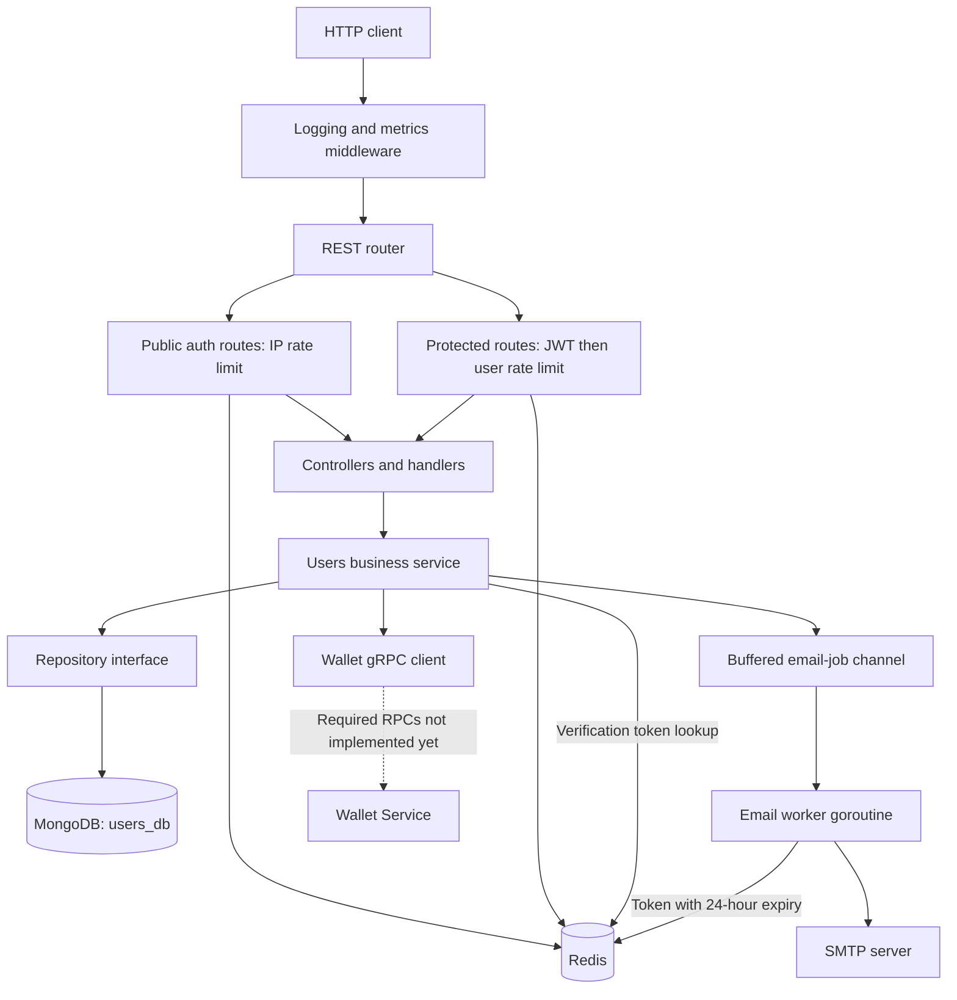

# Users Service (`svc-users`)

An optional extension to the Wallet & Transactions internship project, built to practice authentication, account management, background jobs, and service integration in Go.

**Status: work in progress.** Authentication, profile, and phone-management code is implemented. Wallet proxy routes and their gRPC client exist, but the required Wallet Service RPC implementations are still missing. This README describes the current source code; endpoint definitions do not imply that every flow works end to end.

## Responsibilities

- Register users with an Egyptian national ID, email, password, and mobile number.
- Hash passwords with bcrypt and verify email through an asynchronous SMTP job.
- Issue JWT access and refresh tokens; store refresh-token records in MongoDB.
- Manage profiles, passwords, account soft deletion, and additional phone numbers.
- Apply Redis sliding-window rate limits.
- Check wallet ownership using the user's local `wallet_ids` array and delegate wallet operations over gRPC.
- Record request logs, HTTP metrics, and application tracing spans.

The service owns account data in `users_db`. Wallet balances and financial transactions remain the responsibility of the Wallet and Transactions services. Users currently has no Kafka producer, Kafka consumer, or gRPC server.

## Architecture



### Layers and dependencies

| Layer | Location | Responsibility |
|---|---|---|
| Startup | `cmd/` | Load configuration, connect dependencies, wire components, start HTTP and the email worker, handle shutdown. |
| HTTP transport | `api/rest/` | Register routes, decode requests, read the authenticated user ID, set cookies, and map errors to HTTP responses. |
| Business logic | `internal/users/` | Registration, authentication, profiles, phone rules, ownership checks, and wallet orchestration. |
| Persistence | `external/mongodb/` | Implement the repository interface and create MongoDB indexes. |
| Redis adapter | `external/redis/` | Sliding-window rate limiting and expiring email-verification tokens. |
| Service client | `client/wallet/` | Translate Users DTOs to shared protobuf messages and call Wallet over gRPC. |
| Background work | `Jobs/` | Consume queued email jobs, store tokens, and send verification messages. |
| Utilities | `util/` | JWT signing/validation, logging, metrics, and tracing setup. |

Repository and wallet-client interfaces separate business operations from their implementations. The service also directly uses the Redis adapter, token maker, and email-job channel.

### Request pipeline

```text
All requests:      RequestLogger -> MetricsMiddleware -> Router
Public auth:       IP rate limiter -> Handler -> Service -> Repository/client
Protected routes:  JWT validation -> User rate limiter -> Handler -> Service
```

Public auth routes share a **10 requests/minute per IP** limit. Protected routes share a **60 requests/minute per authenticated user** limit. Redis sorted sets track the sliding window using a transactional pipeline. When a Redis rate-limit check fails, the middleware logs the error and lets the request continue.

Protected handlers get the user ID from the validated token. `/me` avoids accepting a target user ID from the client. An additional `OwnershipMiddleware` exists but is not wired into the router; wallet balance and deletion perform ownership checks in the service/repository instead.

## Files

```text
Users-Service/
|-- README.md
|-- .github/workflows/ci.yml       # Currently empty; no Users CI job defined
`-- svc-users/
    |-- cmd/
    |   |-- main.go               # Dependency wiring, HTTP server, worker, shutdown
    |   `-- config.go             # Environment parsing, defaults, required settings
    |-- api/rest/
    |   |-- controller.go         # Controller holding the Users service
    |   |-- routes.go             # Route registration and middleware composition
    |   |-- middleware.go         # Request logging, metrics, JWT, rate limiting
    |   |-- request_response_handler.go # Auth/profile/phone handlers, cookies, errors
    |   `-- wallet_handler.go     # Create/list/balance/delete wallet handlers
    |-- internal/users/
    |   |-- model.go              # User/refresh-token records, limits, domain errors
    |   |-- dto.go                # API request/response types and validation
    |   |-- repository.go         # Persistence interface
    |   `-- service.go            # Business operations and EmailJob definition
    |-- external/
    |   |-- mongodb/
    |   |   |-- connection.go     # Mongo connection and startup ping
    |   |   `-- repo.go           # Queries, updates, indexes, ownership, token records
    |   `-- redis/client.go       # Redis connection, rate limiter, token helpers
    |-- client/wallet/client.go   # Wallet gRPC client and DTO conversions
    |-- Jobs/email_verification.go # Buffered-channel worker and SMTP delivery
    |-- util/
    |   |-- token/jwt.go          # JWT maker, HS256 signing, token validation
    |   |-- logger/logger.go      # Zerolog configuration and trace correlation
    |   |-- metrics/metrics.go    # Prometheus metric definitions
    |   `-- tracer/tracer.go      # OpenTelemetry provider and optional OTLP exporter
    |-- docs/
    |   |-- docs.go              # Generated Swagger registration
    |   |-- swagger.json         # Generated API specification
    |   `-- swagger.yaml         # Generated API specification
    |-- Dockerfile              # Multi-stage Go build and Alpine runtime
    |-- go.mod / go.sum          # Module dependencies, including published Contracts
    |-- .ENV.example             # Environment template
    |-- .air.toml                # Development reload configuration
    |-- .golangci.yml            # Linter configuration
    |-- .dockerignore / .gitignore
    `-- git-conventional-commits.yaml
```

Shared wallet messages and RPC definitions live in [`../Contracts/wallet/v1/wallet.proto`](../Contracts/wallet/v1/wallet.proto). The root [`docker-compose.yml`](../docker-compose.yml) connects the wider project, and [`implementation_plan.md`](../implementation_plan.md) records an earlier Users design. Some planned details differ from the current implementation, including `wallet_count` versus the implemented `wallet_ids` array.

## Main flows

### Registration and email verification

1. Validate the registration fields, hash the password with bcrypt, and derive a birth date from the national ID.
2. Insert an unverified `ACTIVE` user. If a duplicate national ID belongs to a deleted account, attempt to reactivate that account with updated details and an empty wallet-ID array.
3. Generate a verification token and enqueue an email job in a channel with capacity 100. Registration does not wait for SMTP delivery.
4. The worker stores `email_verify:<token> -> email` in Redis for 24 hours and sends a verification link using SMTP.
5. The verification endpoint resolves the token, sets `is_verified=true`, and deletes the token.

The queue is in memory. A full queue drops the new job with a warning. An SMTP failure deletes its Redis token; no retry or resend endpoint is implemented.

### Login, refresh, logout, and password changes

- Login uses **phone number + password** and requires a verified account that is neither suspended nor deleted.
- Successful login returns an access token in JSON and sets the refresh token in an `HttpOnly`, `SameSite=Strict` cookie named `refresh_token`. The cookie is `Secure` unless `APP_ENV=development` is explicitly configured. The same policy applies when replacing or clearing the cookie.
- Refresh verifies the JWT and stored refresh-token record, then issues a new access token. It does not rotate the refresh token.
- Logout revokes **all** of the user's stored refresh tokens and clears the cookie.
- Password change verifies the old password, saves the new hash, attempts to revoke existing refresh tokens, and issues a fresh access/refresh pair.

Access JWTs contain `token_type: "access"`; refresh JWTs contain `token_type: "refresh"`. Protected-route middleware requires an access token, and the refresh operation requires a refresh token before querying its database record. Verification checks the signature using HS256 only, requires a valid expiration, checks the expected token purpose, and requires the subject to match the nonempty user ID. Missing or unknown purposes are rejected, including older tokens issued before this claim was added; existing users must log in again.

Revoking refresh tokens does not invalidate already-issued access tokens. Refresh-token values are currently stored directly in the field named `token_hash`; hashing is not implemented. Both token purposes still use the same configured signing key; their enforced claim values separate their permitted uses.

### Wallet orchestration (unfinished)

- Creation checks that the selected phone belongs to the user and that fewer than three wallet IDs are recorded, calls Wallet, then adds the returned ID locally.
- Balance lookup checks membership in `wallet_ids` before calling Wallet.
- Deletion removes the ID only if the user owns it, calls Wallet, and attempts to restore the ID if the RPC fails.
- Account deletion marks the user `DELETED`, attempts token revocation, and attempts deletion of all user wallets. Failures in those follow-up operations are logged without undoing the account deletion.

There is no Users-to-Wallet CDC synchronization implemented. Creation and local ID storage are separate writes, so partial failure remains possible. The local wallet-ID limit does not make creation across both services atomic.

## Data and validation

| Collection | Main fields | Indexes |
|---|---|---|
| `users` | `_id`, `national_id`, `full_name`, `birth_date`, `email`, `password_hash`, `phone_numbers`, `is_verified`, `status`, `wallet_ids`, `created_at`, `updated_at` | Unique `national_id`, unique `email`, unique multikey `phone_numbers`. |
| `refresh_tokens` | `_id`, `user_id`, `token_hash`, `revoked`, `expires_at`, `created_at` | Unique `token_hash`, lookup index on `user_id`, TTL index on `expires_at`. |

- Mobile numbers must contain 11 digits and start with `010`, `011`, `012`, or `015`.
- National IDs must contain 14 digits, start with `2` or `3`, and have month/day fields in the ranges 1–12 and 1–31. Complete calendar-date validation is not implemented.
- Names require at least three characters after trimming; passwords require at least eight characters.
- Email validation uses Go's email-address parser.
- A user can hold up to **five phone numbers** and **three recorded wallet IDs**. Repository filters enforce array limits during additions.
- Wallet creation accepts `EGP` (case normalized). The current protobuf creation request sends only user ID and phone number.
- Phone removal checks against removing the last phone and tries to check whether a wallet uses the number. A failed wallet lookup currently allows removal to continue.
- User profiles are read from MongoDB; Redis profile caching is not implemented.

## REST endpoints

Examples assume `SERVER_PORT=8001`, giving a base URL of `http://localhost:8001`. Protected routes require:

```http
Authorization: Bearer <access_token>
Content-Type: application/json
```

### Authentication

| Method | Path | Auth | Input | Success |
|---|---|---|---|---|
| POST | `/v1/users/register` | Public | `full_name`, `phone_number`, `national_id`, `email`, `password` | `201`: `user_id`, `message`, `created_at` |
| GET | `/v1/users/verify-email?token=...` | Public | Verification token in query | `200`: `message` |
| POST | `/v1/users/login` | Public | `phone_number`, `password` | `200`: `user_id`, `access_token`, `expires_in`; refresh cookie |
| POST | `/v1/users/refresh` | Public | Refresh cookie or JSON `refresh_token` | `200`: `access_token`, `expires_in` |
| POST | `/v1/users/logout` | Bearer | No body | `204`; clears refresh cookie |
| PUT | `/v1/users/me/password` | Bearer | `old_password`, `new_password` | `200`: same response shape/cookie as login |

The refresh cookie takes precedence over a JSON token when both are supplied. Refresh tokens are excluded from login/password-change JSON responses. `expires_in` is measured in seconds. Cookie lifetime is currently fixed at 30 days, independently of the configured JWT refresh lifetime.

### Profile and phone numbers

| Method | Path | Auth | Input | Success |
|---|---|---|---|---|
| GET | `/v1/users/me` | Bearer | No body | `200`: user profile |
| PUT | `/v1/users/me` | Bearer | Optional `full_name`, `email` | `200`: updated profile |
| DELETE | `/v1/users/me` | Bearer | No body | `204`: account soft-deleted |
| POST | `/v1/users/me/phones` | Bearer | `phone_number` | `200`: `message` |
| DELETE | `/v1/users/me/phones/{phone}` | Bearer | Phone number in path | `200`: `message` |

The profile response contains `user_id`, `full_name`, `national_id`, `email`, `phone_numbers`, `birth_date`, `is_verified`, `wallet_ids`, `status`, and `created_at`. It does not expose the password hash. When the submitted email differs from the stored address, `email` and `is_verified=false` are saved together in one MongoDB update. Submitting the same address after trimming whitespace, or updating only the name, preserves verification. No new verification message is sent by this endpoint yet; that follow-up is listed below.

### Wallet proxy routes

**These routes are registered, but their corresponding Wallet RPCs are not implemented in the current Wallet server.** The success responses below describe the Users handlers' contracts, not verified end-to-end behavior.

| Method | Path | Auth | Input | Success contract |
|---|---|---|---|---|
| POST | `/v1/users/me/wallets` | Bearer | `phone_number`, `currency_code` | `201`: `wallet_id`, `balance`, `created_at` |
| GET | `/v1/users/me/wallets` | Bearer | No body | `200`: `wallets`, `count` |
| GET | `/v1/users/me/wallets/{wallet_id}/balance` | Bearer | Wallet ID in path | `200`: `wallet_id`, `balance`, `updated_at` |
| DELETE | `/v1/users/me/wallets/{wallet_id}` | Bearer | Wallet ID in path | `204` |

Creation derives `user_id` from the token, overriding any value in the body. Each wallet-list item contains `wallet_id`, `phone_number`, `balance`, and `currency_code`. The client also defines `DeleteUserWallets`, used internally during account deletion.

### Documentation and metrics

| Method | Path | Auth | Purpose |
|---|---|---|---|
| GET | `/v1/swagger/` | Public | Swagger UI and generated specification at `/v1/swagger/doc.json` |
| GET | `/metrics` | Public | Prometheus metrics |

These routes are outside the auth and rate-limit wrappers. No dedicated health endpoint is defined.

### Example payloads

Registration:

```json
{
  "full_name": "Example User",
  "phone_number": "01012345678",
  "national_id": "29901011234567",
  "email": "user@example.com",
  "password": "example-password-change-me"
}
```

Login after verification:

```json
{
  "phone_number": "01012345678",
  "password": "example-password-change-me"
}
```

Wallet creation request (integration pending):

```json
{
  "phone_number": "01012345678",
  "currency_code": "EGP"
}
```

### Error responses

Errors use the shape `{"error":"message"}`.

| Status | Current mapping |
|---|---|
| `400` | Malformed JSON, missing required inputs, invalid names/emails/phone numbers/national IDs/passwords, invalid or expired email-verification tokens, duplicate account fields, unsupported currency, phone/wallet limits, removing the last phone, or a phone not eligible for the requested wallet operation. |
| `401` | Missing/invalid bearer token, invalid credentials, unverified email, suspended/deleted account at login, or invalid/revoked refresh token. |
| `403` | Wallet ownership failure. |
| `404` | User not found or invalid user ID. |
| `429` | Rate limit exceeded. |
| `500` | Infrastructure and unmapped errors, including Redis/database failures and raw gRPC failures. Internal details are hidden behind `internal server error`. |

DTO validation errors wrap `ErrInvalidInput`, which the HTTP handler recognizes with `errors.Is`. Email-verification failures use `ErrInvalidVerificationToken` when the Redis key is missing/expired or its email no longer identifies a user. Redis/database outages remain server errors rather than being mislabeled as invalid tokens. Authentication-token errors continue to return `401`.

## Logging, metrics, and tracing

`RequestLogger` emits one `request completed` entry after the handler returns. It measures elapsed time with `time.Since(start)` and records it as `duration` using Zerolog's duration field. With Zerolog's default configuration, this numeric value is in **milliseconds**. It includes downstream calls made during request handling, but does not wait for queued email delivery.

Other fields include method, path, status, bytes read/written, remote address, user agent, and `layer=api`. Statuses below 400 log at INFO, 4xx at WARN, and 5xx at ERROR. The logger uses readable console output by default and JSON when `APP_ENV=production` is set before initialization.

The request logger attempts to include `user_id`, but the current outer middleware does not receive the derived context created inside JWT middleware, so that field is generally absent from completion logs. Logger helpers attach trace/span IDs when their context contains a valid span.

HTTP metrics are exposed at `/metrics`:

- `http_requests_total`
- `http_request_duration_seconds`
- `http_request_bytes_read`
- `http_response_bytes_written`

`mongodb_operation_duration_seconds` is declared but repository timing observations are not wired in. Handlers, service methods, and repository methods create tracing spans. Setting `OTEL_EXPORTER_OTLP_ENDPOINT` enables export; automatic incoming HTTP and outgoing Wallet gRPC trace propagation are not wired into Users yet.

## Configuration and local development

The module declares Go **1.26.5**. Local development also needs MongoDB, Redis, an SMTP server for verification, and a Contracts version that contains the RPC messages used by the Wallet client. Wallet must be available for wallet operations once its missing RPCs are implemented.

Create `svc-users/.ENV` using the template, then fill in the settings:

| Variable | Default / requirement |
|---|---|
| `MONGO_URI` | Required. MongoDB connection string. |
| `MONGO_DB_NAME` | `users_db` |
| `REDIS_ADDR` | `localhost:6379` |
| `WALLET_GRPC_URL` | Required; local Wallet normally uses `localhost:50051`. |
| `JWT_SECRET` | Required; at least 32 characters. |
| `JWT_ACCESS_EXPIRY` | `15m`; parsed as a Go duration. |
| `JWT_REFRESH_EXPIRY` | `168h` (7 days); parsed as a Go duration. |
| `SERVER_PORT` | Code default is `8080`; set **`8001`** to match Compose and avoid Transactions' port. |
| `SMTP_HOST` / `SMTP_USER` / `SMTP_PASS` | SMTP delivery settings; no configured defaults. |
| `SMTP_PORT` | `587` |
| `SENDER_EMAIL` | `noreply@antigravity.wallet`; configure a sender accepted by your SMTP server. |
| `OTEL_EXPORTER_OTLP_ENDPOINT` | Optional OTLP HTTP host:port, e.g. `localhost:4318` or `jaeger:4318` inside Docker. |
| `APP_ENV` | `development` explicitly disables the refresh cookie's `Secure` flag for local HTTP. Any other value, including unset, keeps `Secure=true`. Set `production` in the process environment for JSON logs. |

From this directory:

```powershell
cd svc-users
Copy-Item .ENV.example .ENV # First-time setup only; preserve an existing .ENV
# Edit .ENV with your local configuration, including SERVER_PORT=8001.
go run ./cmd
```

MongoDB and Redis are checked during startup. The gRPC connection is created at startup, but that does not verify that the required Wallet RPCs are supported.

### Current integration limits

- The email worker hardcodes verification links to `http://localhost:8080`. When Users runs on 8001, use the same token against `http://localhost:8001/v1/users/verify-email?token=...`; configurable public URLs remain to be implemented.
- For local HTTP cookie testing, use `APP_ENV=development` in `.ENV` or the process environment. All other environments require HTTPS for normal browser cookie use; the application itself does not configure TLS termination.
- The current `go.mod` uses a published Contracts version without a local replacement. That dependency lacks the newer Wallet methods/messages used by `client/wallet`, so the full Users build is currently blocked by undefined RPC symbols. If a local `../../Contracts` replacement is restored, the Docker build context/layout must also include that sibling module.
- Wallet's server currently implements `GetWallet` and legacy `ModifyBalance` only. Users requires `CreateWallet`, `GetUserWallets`, `GetWalletBalance`, `DeleteWallet`, and `DeleteUserWallets`.
- Account status checks remain incomplete across protected operations; email verification represents email ownership, not external identity/KYC verification. Token-purpose separation is enforced independently of those account-status checks.

## Deferred issues to revisit

These items are documented follow-up work, not implemented fixes. Wallet integration remains deferred separately above.

- [ ] **Prove ownership before reactivating deleted accounts.** `RegisterUser` currently accepts the national ID of a deleted account and replaces its email, phones, and password. Verification of the new email does not prove ownership of the original account. Require an authenticated recovery flow or proof through the original verified contact before restoring that identity. See `internal/users/service.go`, `RegisterUser`.
- [ ] **Enforce current account status across protected operations and refresh.** Login checks status, but JWT middleware and refresh do not consistently consult current account state. An existing access token can pass authentication after suspension/deletion. Define and implement the account-status check and session-invalidation policy. See `api/rest/middleware.go` and `internal/users/service.go`.
- [ ] **Handle failed session revocation reliably.** Password change and account deletion currently log refresh-token revocation failures and continue. Old refresh tokens can remain usable after such a failure. Make the state change and revocation consistent, or add a reliable recovery mechanism. Existing access tokens also remain valid until expiry; decide whether immediate invalidation is needed.
- [ ] **Make the last-phone rule atomic.** `RemovePhoneNumber` checks the array length before a separate database update. Two concurrent requests can both see two numbers, then remove one each and leave no login phone. Enforce the minimum inside the MongoDB update filter. Wallet lookup errors also currently allow removal to proceed; revisit that behavior when integrating Wallet. See `external/mongodb/repo.go` and `internal/users/service.go`.
- [ ] **Recover from lost verification emails.** The in-memory queue drops jobs when full, pending jobs can be lost on process failure, and SMTP failures have no retry/resend path. Registration can succeed while the user cannot verify or log in. Add resend/retry handling and a delivery strategy appropriate to the project. See `Jobs/email_verification.go` and `RegisterUser`.
- [ ] **Complete verification after email changes.** Profile updates now clear verification atomically with the changed email, but do not send a new verification link. Add a verification job or resend flow for the new address. Until then, changing email prevents subsequent login until the new address is verified. Existing access tokens are not revoked by this update.
- [ ] **Store hashes of refresh tokens.** `token_hash` currently contains the usable token itself. Hash before storing and hash the incoming token for database lookup/revocation, with a plan for existing records. This reduces the usefulness of a database-only credential leak. See `Login`, `RefreshToken`, `ChangePassword`, and the refresh-token repository methods.
- [ ] **Make verification URLs configurable.** Replace the hardcoded `http://localhost:8080` with a configured public base URL matching the Users deployment. See the setup limitation above.
- [ ] **Align cookie lifetime with token configuration.** Refresh cookie `Max-Age` is fixed at 30 days while the refresh JWT defaults to seven days and is configurable. Derive cookie lifetime from the issued token's expiration.

## Verification

From `svc-users`:

```powershell
go build ./...
go test ./...
```

Authentication tests run without external services:

| Test file | Coverage |
|---|---|
| `svc-users/util/token/jwt_test.go` | Valid token purposes, cross-purpose rejection, missing/unknown claims, expiry, subject consistency, signatures, and algorithm restriction. |
| `svc-users/api/rest/auth_test.go` | Refresh tokens rejected as bearer access tokens; cookie attributes when setting and clearing in both secure modes. |
| `svc-users/internal/users/auth_test.go` | Access tokens rejected before refresh-token lookup, valid refresh issuing an access token, and revoked refresh rejection. |
| `svc-users/cmd/config_test.go` | Only explicit development disables secure cookies; other and missing environment values retain secure cookies. |
| `svc-users/internal/users/profile_test.go` | Changed/same/omitted email behavior, paired email/verification updates, invalid profile rejection, and invalid verification tokens versus infrastructure failures. |
| `svc-users/api/rest/errors_test.go` | Client validation errors mapped to `400` and unexpected server errors kept masked as `500`. |

End-to-end validation still needs MongoDB, Redis, working SMTP, and completed Wallet integration. The empty Users CI file does not currently run these checks automatically.

While the Contracts mismatch blocks `go test ./...`, the authentication checks can run independently:

```powershell
go test ./util/token ./api/rest ./internal/users
go test ./cmd/config.go ./cmd/config_test.go
```
